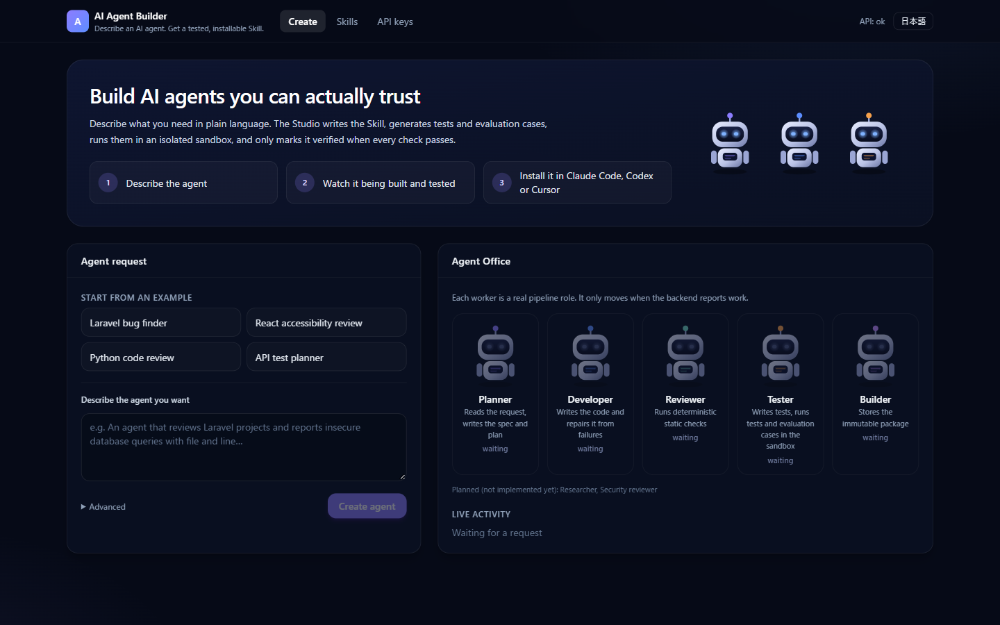

# AI Agent Builder

Describe an AI agent in plain language (English or Japanese). The Studio writes a reusable Skill, generates tests
and evaluation cases from your request, runs them in an isolated Docker sandbox, and marks the Skill **verified**
only when every objective check passes. Verified and validated Skills install into Claude Code, Codex and Cursor.

就職作品 — HAL名古屋 · 日本語の手順: [docs/ja/QUICKSTART.md](docs/ja/QUICKSTART.md)



## What works today (verified by tests)

| Capability | Status |
|---|---|
| Agent Studio UI: chat request, templates, Agent Office driven by real backend events, result tabs, EN/JA | Implemented · Vitest + Playwright (desktop & mobile) |
| Skill generation pipeline (Ollama): spec → eval cases → code → tests → bounded repair → sandbox → evaluation | Implemented · pytest |
| Objective `verified`: static checks, ≥3 asserting unit tests, all eval cases incl. a hidden holdout, schema, determinism | Implemented · negative controls in pytest |
| Docker sandbox (no network, read-only, unprivileged, resource limits, timeout) | Implemented · real-Docker tests |
| Export ZIP + non-overwriting install commands; real install in Claude Code and Codex | Implemented · external E2E evidence in `docs/evidence/` |
| `/v1` API with hashed API keys, rate limit, audit log; Python SDK | Implemented · pytest |
| Reproducible generation benchmark (seeds, model digests, suspend detection, resume) | Implemented · `docs/benchmarks/` |
| GitHub integration, user accounts, visual workflow editor, 3D scene | **Not implemented** |

**Honest limitation:** with the local models tested (llama3.2:3b, qwen2.5-coder 7B), **0 of 30 generated code
Skills reached `verified`** (benchmark B). The validator works (the 5 human-written reference Skills are verified);
the models' code is not yet good enough. See [docs/benchmarks/PHASE1_ANALYSIS.md](docs/benchmarks/PHASE1_ANALYSIS.md).

## Requirements

- Node.js 22+, npm 10+
- [uv](https://docs.astral.sh/uv/) (provides Python 3.12)
- Docker Desktop (Postgres + sandbox) · `docker pull python:3.12-slim`
- [Ollama](https://ollama.com) · `ollama pull qwen2.5-coder` (default model; configurable with `LLM_MODEL`)

## Run locally

```bash
docker compose up -d db                                   # Postgres on 127.0.0.1:5433
cd apps/api
uv sync
.venv/Scripts/python.exe -m alembic upgrade head
.venv/Scripts/python.exe -m uvicorn app.main:app --port 8000   # API on the host (needs the docker CLI for the sandbox)
# another terminal, repository root:
npm install
npm run dev:web                                           # http://localhost:5173 (proxy /api -> :8000)
```

Optional: `POST /studio/reference/seed` imports the five human-written reference Skills (validated in the sandbox).
Settings (see `.env.example`): `LLM_MODEL`, `OLLAMA_BASE_URL`, `DATABASE_URL`, `STORAGE_DIR`, `SANDBOX_IMAGE`,
`RATE_LIMIT_PER_MINUTE`, `ALLOWED_HOSTS`.

## Tests

See [docs/TESTING.md](docs/TESTING.md). Short version:

```bash
cd apps/api && .venv/Scripts/python.exe -m pytest -q      # backend (Docker running → no skips)
npm test && npm run build                                 # web + contracts
cd apps/web && npx playwright test                        # browser, desktop + mobile
```

## Documentation

- [docs/architecture.md](docs/architecture.md) · [docs/skills.md](docs/skills.md) (package, pipeline, statuses, export, API, SDK)
- [docs/SECURITY.md](docs/SECURITY.md) · [docs/KNOWN_LIMITATIONS.md](docs/KNOWN_LIMITATIONS.md)
- [docs/benchmarks/](docs/benchmarks/) · [docs/FINAL_PRODUCT_ROADMAP.md](docs/FINAL_PRODUCT_ROADMAP.md)
- 日本語: [クイックスタート](docs/ja/QUICKSTART.md) · [企業導入準備状況](docs/ja/ENTERPRISE_READINESS.md)
