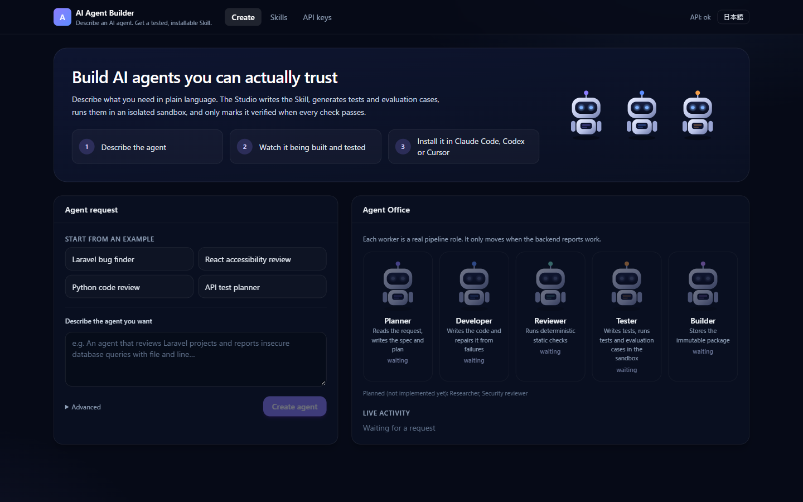

# AI Agent Builder

Describe an AI agent in plain language (English or Japanese). The Studio writes a reusable Skill, generates tests
and evaluation cases from your request, runs them in an isolated Docker sandbox, and marks the Skill **verified**
only when every objective check passes. Verified and validated Skills install into Claude Code, Codex and Cursor.

就職作品 — HAL名古屋 · 日本語の手順: [docs/ja/QUICKSTART.md](docs/ja/QUICKSTART.md)

> **This branch** (`feature/phase1-compiler-reliability`, the repository's default branch) holds the Phase 1 code of
> 2026-11-09. Later work is on other branches: `integration/hal-readiness` (documentation and audit),
> `audit/security-hardening` (security fixes, Demo Mode, UX redesign, UGREEN Hackathon Skill) and
> `feature/nas-project-memory-runtime` (NAS Project Memory simulation harness). Nothing described below comes from them.



## What works today (verified by tests)

| Capability | Status |
|---|---|
| Agent Studio UI: chat request, templates, Agent Office driven by real backend events, result tabs, EN/JA | Implemented · Vitest + Playwright (desktop & mobile) |
| Skill generation pipeline (Ollama): spec → eval cases → code → tests → bounded repair → sandbox → evaluation | Implemented · pytest |
| Objective `verified`: static checks, ≥3 asserting unit tests, all eval cases incl. a hidden holdout, schema, determinism | Implemented · negative controls in pytest |
| Docker sandbox (no network, read-only, unprivileged, resource limits, timeout) | Implemented · real-Docker tests |
| Export ZIP + non-overwriting install commands; real install in Claude Code and Codex | Implemented · external E2E evidence in `docs/evidence/` |
| `/v1` API with hashed API keys, rate limit, audit log; Python SDK | Implemented · pytest |
| Reproducible generation benchmark (seeds, model digests, suspend detection, resume) | Implemented · `docs/benchmarks/` |
| GitHub integration, user accounts, visual workflow editor, 3D scene, public demo mode | **Not implemented** |

**Honest limitation:** with the local models tested (llama3.2:3b, qwen2.5-coder 7B), **0 of 30 generated code
Skills reached `verified`** (benchmark B). The validator works (the 5 human-written reference Skills are verified);
the models' code is not yet good enough. See [docs/benchmarks/PHASE1_ANALYSIS.md](docs/benchmarks/PHASE1_ANALYSIS.md).
`verified` means the Skill passed the checks and cases it was given, not that it is correct for every input.

## Architecture

```text
Browser ── React + TypeScript Studio (apps/web) ── /api proxy ──▶ FastAPI (apps/api, on the host)
                                                                   ├─ PostgreSQL (jobs, Skills, versions, keys, audit)
                                                                   ├─ STORAGE_DIR (immutable Skill packages)
                                                                   ├─ Ollama (local model)
                                                                   └─ docker run ▶ sandbox container per test/eval run
```

- `apps/api/app/skills/`: pipeline, static validation, sandbox runner, evaluation, package storage, export adapters.
- `apps/api/app/api/`: `studio` (local Studio API), `office` (pipeline roles and live events), `public` (`/v1`).
- The five "agents" in the Agent Office are **pipeline roles** (Architect, Coder, Reviewer, Tester, Packager), each
  shown from real events written by the pipeline; they are not autonomous agents.
- Design notes: [docs/architecture.md](docs/architecture.md), [docs/adr/](docs/adr/).

## Requirements

- Node.js 22+, npm 10+
- [uv](https://docs.astral.sh/uv/) (provides Python 3.12)
- Docker Desktop (Postgres + sandbox) · `docker pull python:3.12-slim`
- [Ollama](https://ollama.com) · `ollama pull qwen2.5-coder` (default model; configurable with `LLM_MODEL`)

## Run locally

```bash
cp .env.example apps/api/.env                             # then set your own Postgres password; never commit .env
docker compose up -d db                                   # Postgres on 127.0.0.1:5433
cd apps/api
uv sync
.venv/Scripts/python.exe -m alembic upgrade head
.venv/Scripts/python.exe -m uvicorn app.main:app --port 8000   # API on the host (needs the docker CLI for the sandbox)
# another terminal, repository root:
npm install
npm run dev:web                                           # http://localhost:5173 (proxy /api -> :8000)
```

Optional: `POST /studio/reference/seed` imports the five human-written reference Skills (validated in the sandbox).

### Configuration (`apps/api/.env`)

| Variable | Default | Purpose |
|---|---|---|
| `DATABASE_URL` | `postgresql+psycopg://aab:<password>@127.0.0.1:5433/aab` | database |
| `OLLAMA_BASE_URL` | `http://127.0.0.1:11434` | local model server |
| `LLM_MODEL` | `qwen2.5-coder:latest` | generation model |
| `STORAGE_DIR` | `data` | Skill package storage |
| `SANDBOX_IMAGE` | `python:3.12-slim` | sandbox image |
| `RATE_LIMIT_PER_MINUTE` | `30` | `/v1` rate limit per key |
| `STUDIO_LOCAL_ONLY` | `true` | Studio answers loopback clients only |
| `ALLOWED_HOSTS` | `localhost, 127.0.0.1, [::1]` | Host header allowlist (DNS rebinding defence) |

## API endpoints

| Route | Access | Purpose |
|---|---|---|
| `POST /studio/skills/plan`, `POST /studio/skills/generate`, `GET /studio/jobs[/{id}]` | Studio (local) | plan and generate a Skill, follow jobs |
| `GET /studio/skills`, `GET /studio/versions/{id}[/files/{path}]`, `POST /studio/versions/{id}/validate` | Studio (local) | Skills, versions, files, revalidation |
| `GET /studio/versions/{id}/export/{target}`, `GET /studio/versions/{id}/install/{target}` | Studio (local) | ZIP and install commands (`claude-code`, `codex`, `cursor`, `canonical`) |
| `POST /studio/projects/analyze`, `POST /studio/versions/{id}/project/plan` and `/apply` | Studio (local) | install a Skill into a project folder, with a plan first |
| `POST/GET/DELETE /studio/api-keys`, `GET /studio/audit`, `GET /studio/evaluations` | Studio (local) | keys, audit log, evaluation history |
| `GET /studio/agents`, `GET /studio/events`, `GET /studio/runs/{id}/events` | Studio (local) | Agent Office roles and events |
| `GET /v1/skills[/{slug}]`, `POST /v1/skills/{slug}/run`, `GET /v1/runs/{id}` | `Authorization: Bearer <API key>` | run a stored Skill in the sandbox |

```bash
curl -X POST http://localhost:8000/v1/skills/python-code-analyzer/run \
  -H "Authorization: Bearer <your-api-key>" -H "Content-Type: application/json" \
  -d '{"files": {"main.py": "def run(): pass\n"}}'
```

## Security model

- Generated code runs only in Docker: `--network none`, read-only root, uid 65534, all capabilities dropped,
  `no-new-privileges`, 256 MB, 1 CPU, 64 PIDs, timeout. The host never executes it.
- Package paths are normalized against an allowlist; generated files are scanned for secrets and unsafe instructions.
- API keys are stored as SHA-256 hashes; `/v1` is rate limited and logged.
- The Studio has no user accounts: it serves loopback clients only and checks the Host header. Do not expose it.
- Details and open risks: [docs/SECURITY.md](docs/SECURITY.md).

## UGREEN NAS integration

**None on this branch.** This branch has no UGREEN or NAS code. The UGREEN Hackathon Skill is on
`audit/security-hardening`; a local, simulated harness for it is on `feature/nas-project-memory-runtime`.

## Demo

There is no public demo mode on this branch; show the Studio locally (see *Run locally*). A full generation takes
minutes with a local model. The real-generation browser test (`RUN_REAL_GENERATION=1`) records an actual run.

## Tests

See [docs/TESTING.md](docs/TESTING.md). Short version:

```bash
cd apps/api && .venv/Scripts/python.exe -m pytest -q      # backend (Docker running → no skips)
npm test && npm run build                                 # web + contracts
cd apps/web && npx playwright test                        # browser, desktop + mobile
```

Results on this branch: backend **184 passed, 0 skipped** (re-run 2026-11-16, Windows, real Docker sandbox). Frontend,
SDK and Playwright results are those recorded on 2026-11-06 in [docs/TESTING.md](docs/TESTING.md); they were not
re-run for this README. That file still lists 139 backend tests from 2026-11-06; the 184 above is the current count.

## Documentation

- [docs/architecture.md](docs/architecture.md) · [docs/skills.md](docs/skills.md) (package, pipeline, statuses, export, API, SDK)
- [docs/SECURITY.md](docs/SECURITY.md) · [docs/KNOWN_LIMITATIONS.md](docs/KNOWN_LIMITATIONS.md)
- [docs/benchmarks/](docs/benchmarks/) · [docs/FINAL_PRODUCT_ROADMAP.md](docs/FINAL_PRODUCT_ROADMAP.md)
- 日本語: [クイックスタート](docs/ja/QUICKSTART.md) · [企業導入準備状況](docs/ja/ENTERPRISE_READINESS.md)
