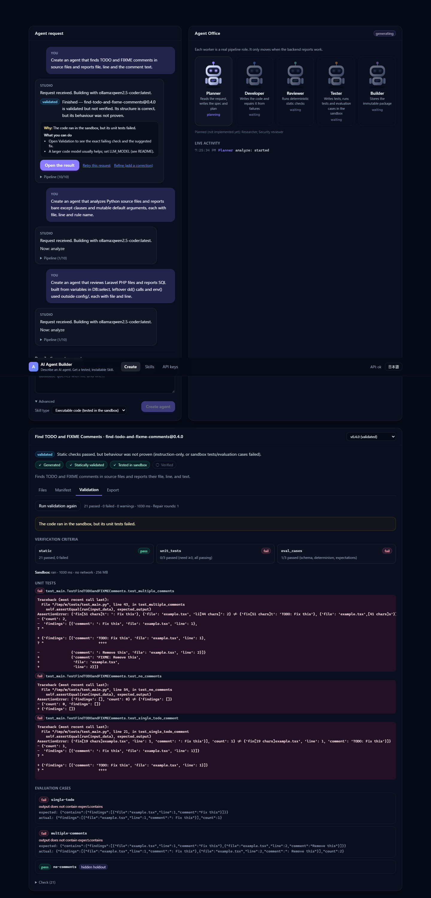
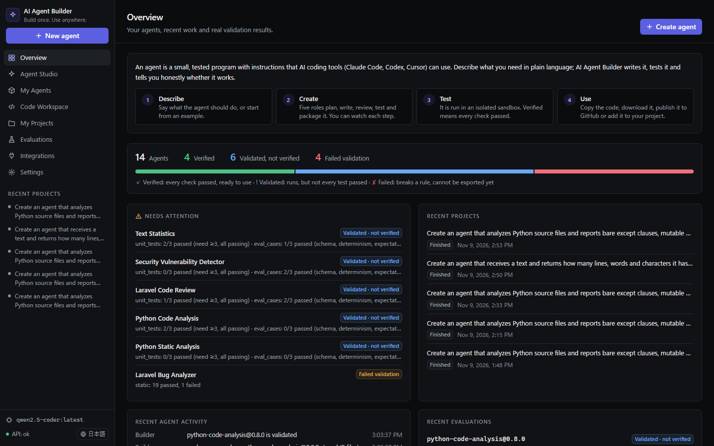
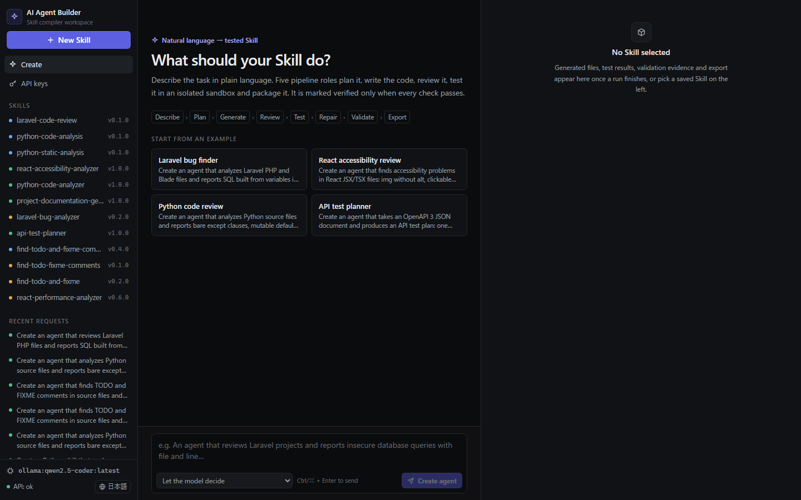
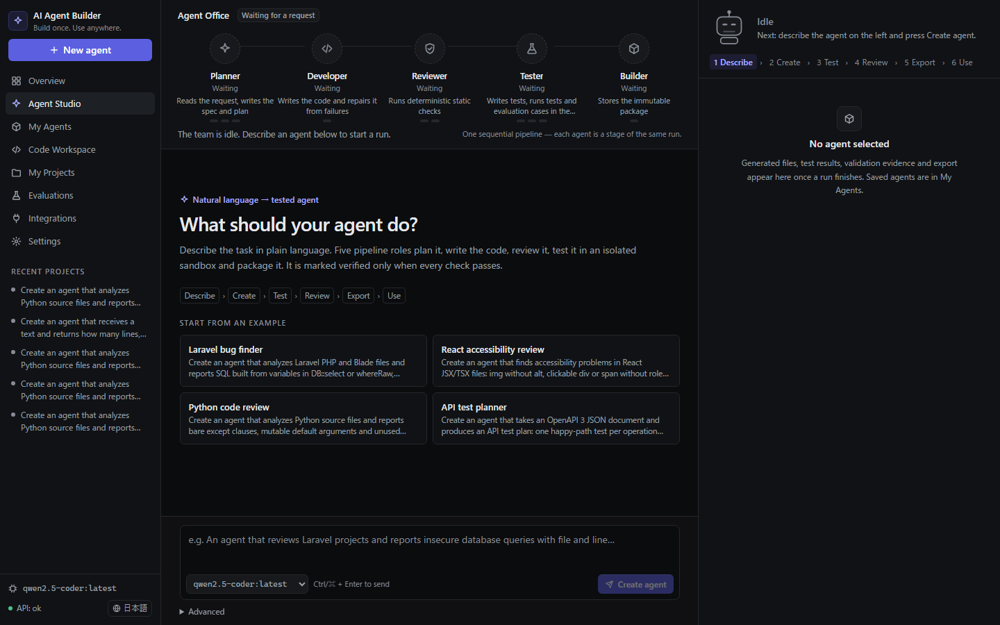
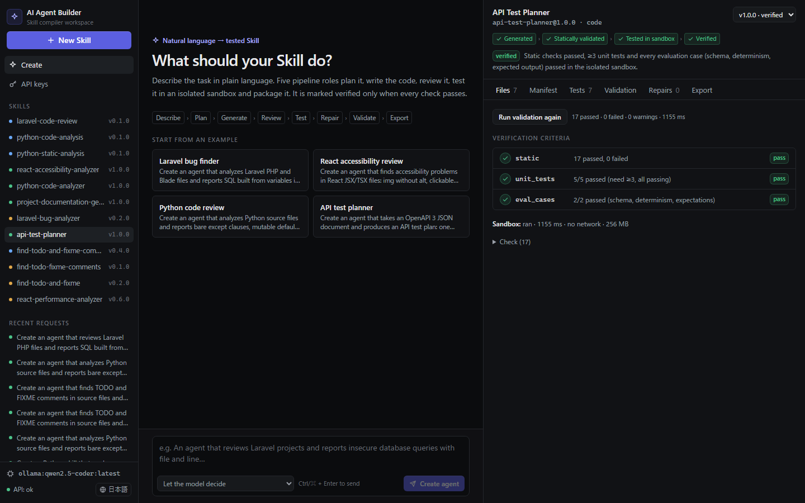
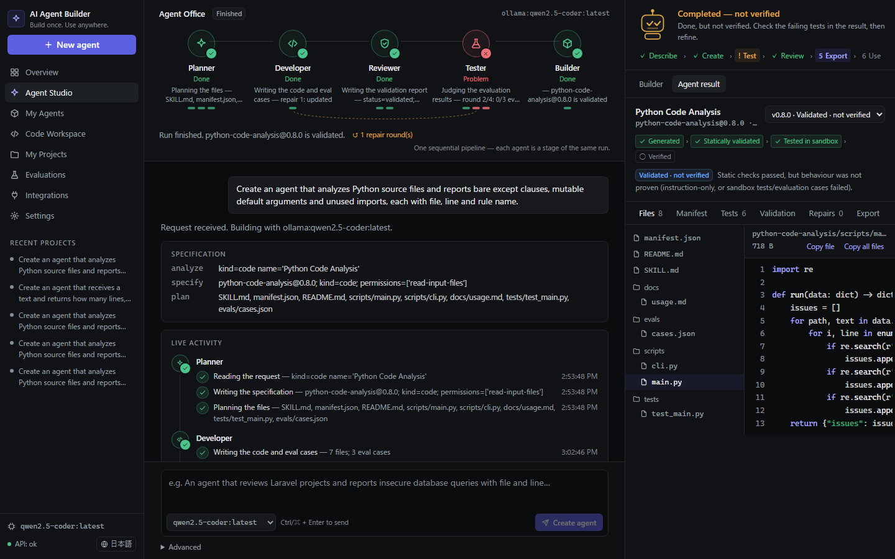

# UI: before and after

All screenshots are of the real application with real data. "Before" images were recovered from git history
(commit `7078a46`, 2026-11-06); "after" images were captured by `apps/web/e2e/screenshots.spec.ts`.

| | Before | After |
|---|---|---|
| First screen |  |  |
| Agent Studio |  |  |
| A result |  |  |

More "after": `final-studio-run-failed.png` (a real run that failed validation), `final-my-agents.png`,
`final-code-workspace.png`, `final-evaluations.png`, `final-mobile-ja-overview.png`, `final-mobile-ja-studio.png`.

## What changed, and why it is better

| Area | Before | After | Why it matters |
|---|---|---|---|
| Structure | One page: hero banner, request form, robot cards | Eight pages with a sidebar (drawer on mobile): Overview, Agent Studio, My Agents, Code Workspace, My Projects, Evaluations, Integrations, Settings | Each task has one place; deep links (`#/code/<id>/export`) and back/forward work |
| First visit | Hero text about trust | "How it works": what an agent is, Describe → Create → Test → Use, one primary action | A beginner learns what the product does before any jargon |
| Progress | Five identical robots, mostly "waiting" | One robot whose state is the real running stage, a user-level path (Describe → Use) and a five-role Office with real handoffs | Shows who is working and what happens next; nothing animates without a real stage |
| Honesty of results | `verified`/`validated` raw words | Plain labels; "Completed — not verified" in amber; a finished job is neutral, not green; failed agents show "See what failed", never a download | A failed test can never look like success |
| After a run | Open the result | "Use this agent": view code, download, GitHub/install commands, add to project, run tests again | The next step is visible where the user already is |
| Evidence | Text only | Evidence ladder everywhere, per-file validation errors on the right line, "Did refining help?" chart per agent | Answers "why this status?" and "did my change help?" with real numbers |
| Accessibility | Faint text 3.6:1 | 5.6:1; ≥24 px targets; keyboard path; status never colour-only; checked at 1920/1440/768/390/360 px | Readable for more people, on more devices |

## Unfinished

- No usability study with real people; the persona journeys are automated click-count checks.
- The local model (`qwen2.5-coder`) has not produced a **verified** agent in the last 20+ real runs; the UI reports
  that honestly, so the "successful run" screenshot shows "Completed — not verified".
- Some backend messages inside the activity log (e.g. "… is validated") are English in the Japanese UI.
